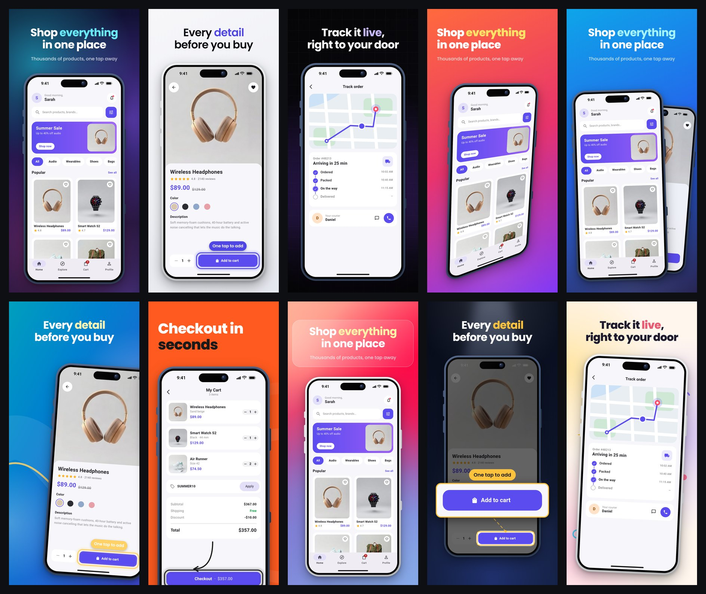
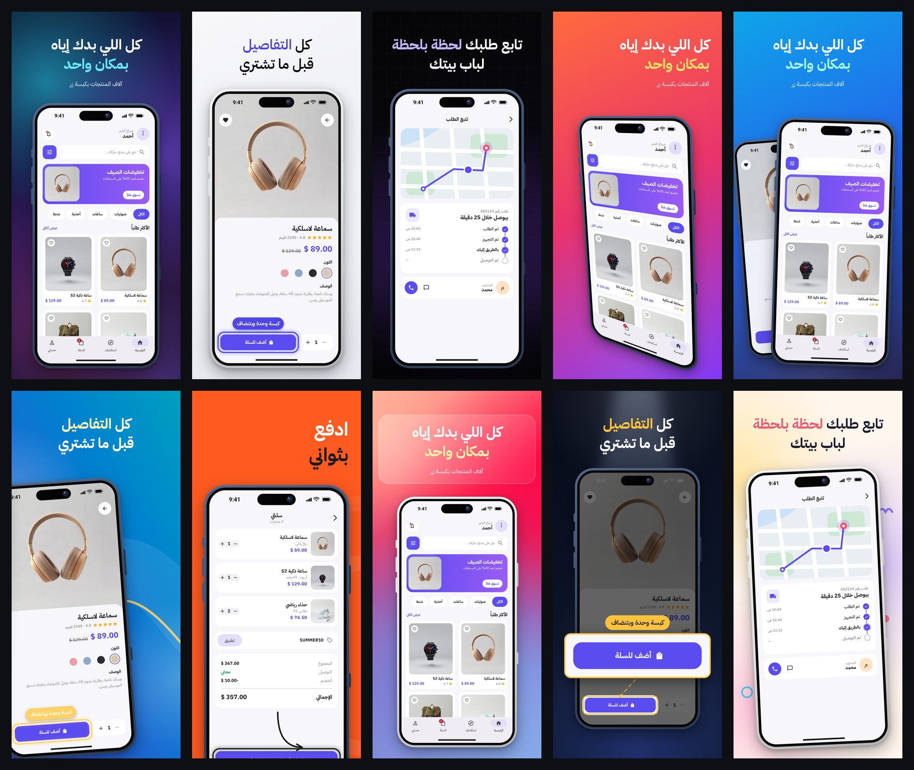
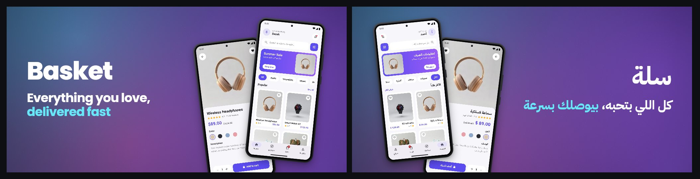
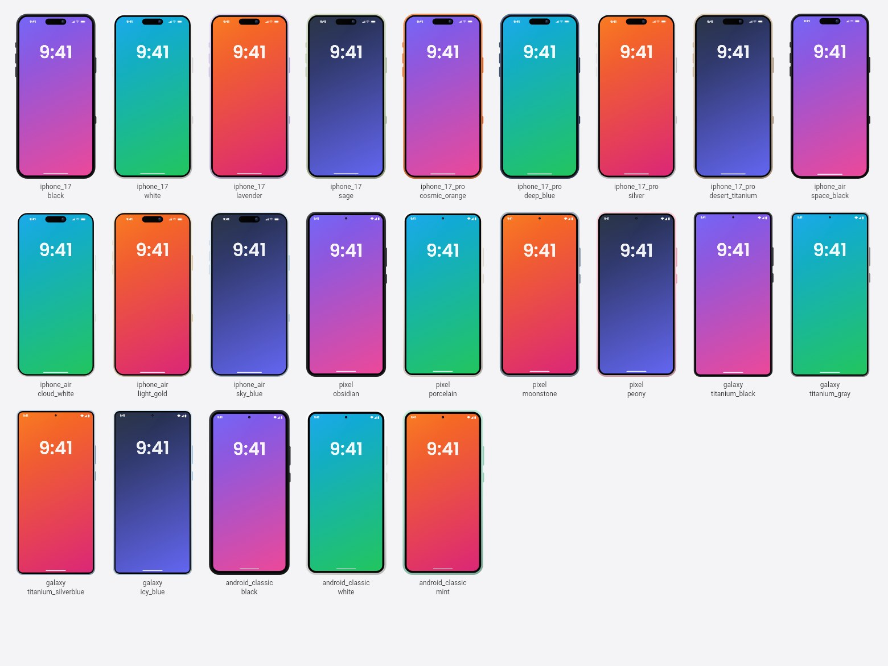

<h1 align="center">store_shots</h1>

<p align="center">
  <b>App Store &amp; Google Play screenshots from your Flutter app, generated inside <code>flutter test</code>.</b><br>
  Device frames · translated captions · real Arabic RTL · 10 templates · widget highlights · Play Feature Graphic.<br>
  No emulator, no Mac, no Figma.
</p>

<p align="center">
  
  
  
  
</p>

<p align="center"></p>
<p align="center"></p>
<p align="center"><sub>Every image above was generated by this package from the <a href="example/">example app</a>, unedited.</sub></p>

---

## Quick start

```bash
flutter pub add --dev store_shots
dart run store_shots init     # creates store_shots.yaml, the test file and a caption file
dart run store_shots          # → build/store_shots/
```

That's it. `init` writes three small files you then edit:

```yaml
# store_shots.yaml
template: aurora                       # dart run store_shots templates
devices: [iphone_6_9, android_phone]   # dart run store_shots devices
screens:
  - id: home
    route: /
  - id: product
    route: /product/1
    highlight: add_to_cart             # the ValueKey of a widget to circle
```

```dart
// test/store_shots_test.dart
import 'package:store_shots/store_shots.dart';
import 'package:my_shop/main.dart';

void main() => storeShots(app: (_) => const MyShopApp());
```

```json
// lib/l10n/store_en.arb  (add store_ar.arb, store_de.arb... for more languages)
{ "caption_home": "Shop *everything*\nin one place", "caption_product": "Every *detail* before you buy" }
```

```
▶ store_shots: 4 screens × 2 locales (en, ar) × 2 devices (iphone_6_9, android_phone) · template: aurora
✔ store_shots: 4 screens × 2 locales × 2 devices = 16 screenshots + 2 feature graphics (10.7s)
  → build/store_shots/gallery.html
```

## Features

| | |
|---|---|
| **One config file** | Screens, locales, devices, template. Everything else has a sensible default: no `locales`? It uses every `store_<locale>.arb` it finds. No `devices`? iPhone 6.9" + Android phone. |
| **Runs in `flutter test`** | Each device is simulated with `tester.view` (exact size, pixel ratio, safe areas). Works on Linux CI. |
| **Real fonts, never boxes** | Your app fonts (from `FontManifest.json`), Material Icons and a bundled Roboto + Noto Arabic stand-in for the system font, so Latin *and* Arabic render on any machine. |
| **10 templates** | `aurora`, `clean`, `midnight`, `tilted`, `duo`, `panorama`, `bold`, `glass`, `spotlight`, `pastel`, or `none` for raw screenshots. |
| **Device frames drawn in Dart** | 3 iPhone-style + 3 Android-style models (plus iPad and Android tablet), 2–5 colors each. No copyrighted artwork. |
| **Status bar** | 9:41, full battery, signal and Wi-Fi; dark or light icons picked from your screen automatically. |
| **Captions from ARB** | `*word*` is drawn in the accent color, `\n` breaks lines, `<key>_subtitle` adds a second line. The font shrinks to fit. |
| **Arabic & RTL** | Layout, captions, highlights, panoramas and the Feature Graphic all mirror for `ar`, `fa`, `he`, `ur`. |
| **Fake data API** | `overrides: (locale) => [...]` gives each language its own believable data (Riverpod, Provider, BLoC, get_it…). |
| **Highlights** | `ring`, `arrow` or `spotlight` around any widget found by its `ValueKey`, with an optional translated label. |
| **Feature Graphic** | Google Play's required 1024×500 banner, per language, in your template. |
| **Store-ready output** | Exact store sizes, 24-bit PNG without alpha (both stores reject alpha), fastlane `deliver`/`supply` folders, `gallery.html`, `manifest.json`. |
| **Light + dark** | `theme: [light, dark]` renders both (your app follows `platformBrightness`). |

## Templates

| | | | | |
|:-:|:-:|:-:|:-:|:-:|
| **aurora** (default)<br>deep indigo, glowing blobs | **clean**<br>Apple-keynote calm | **midnight**<br>neon glow on black | **tilted**<br>3D-tilted device | **duo**<br>next screen peeks behind |
| **panorama**<br>one scene across all shots | **bold**<br>huge headline, device bleeds off | **glass**<br>frosted card on a mesh | **spotlight**<br>zooms into your highlight | **pastel**<br>playful shapes |

```yaml
template: glass                    # one template = your store set
templates: [aurora, bold, glass]   # or several: the first is the store set, the rest go to variants/
background: { gradient: ["#0F172A", "#4F46E5"] }   # optional overrides on any template
accent: "#F59E0B"
caption_color: "#FFFFFF"
```

Try them all without touching the config: `dart run store_shots --template all`, then open `build/store_shots/gallery.html`.

**Google Play Feature Graphic**, generated per language in the same look (1024×500):

<p align="center"></p>

## Device frames

<p align="center"></p>

```yaml
frames:
  ios: iphone_17_pro/deep_blue       # iphone_17 · iphone_17_pro · iphone_air
  android: galaxy/titanium_gray      # pixel · galaxy · android_classic
# frame: false                        # rounded screen, no hardware
```

`dart run store_shots frames` lists every color. Without a choice, the frame color follows the template (dark finish on dark backgrounds, light on light). Shapes are generic "inspired by" drawings: no logos, no Apple or Google artwork.

## Store sizes

Checked against the official pages on **4 November 2026**:

| id | Store | Size (px) | Notes |
|---|---|---|---|
| `iphone_6_9` | App Store | 1320 × 2868 | 6.9" (Air / 17 Pro Max class). Accepted for the large Dynamic Island slot. |
| `iphone_6_5` | App Store | 1284 × 2778 | 6.5", used if no 6.9" set is provided. |
| `iphone_6_3` | App Store | 1206 × 2622 | 6.3" (17 / 17 Pro class). **Apple's currently required iPhone size** (Dynamic Island, medium display). |
| `ipad_13` | App Store | 2064 × 2752 | Required if your app runs on iPad. |
| `android_phone` | Google Play | 1080 × 1920 | 9:16, the minimum Play recommends for its large-format placements. |
| `android_tablet_7` | Google Play | 1440 × 2560 | 9:16 (tablets: 1080–7680 px). |
| `android_tablet_10` | Google Play | 2160 × 3840 | 9:16. |
| Feature Graphic | Google Play | 1024 × 500 | Required for every Play listing. |

Sources: Apple, [Screenshot specifications](https://developer.apple.com/help/app-store-connect/reference/app-information/screenshot-specifications) · Google, [Add preview assets to showcase your app](https://support.google.com/googleplay/android-developer/answer/9866151). Both stores reject images with an alpha channel; store_shots always writes opaque RGB PNGs. Apple accepts up to 10 screenshots per size, Google Play up to 8 per device type; the config is validated against both.

> Apple scales your largest set down for smaller iPhones when your UI is the same, so `iphone_6_9` alone is usually enough. Add `iphone_6_3` if you want pixel-exact shots in the required slot.

## Fake data

Real screens are only as good as their data. `overrides` is called once per locale and its result is handed to `app`, so each language gets its own names, prices and photos.

**Riverpod** (what the example uses):

```dart
void main() => storeShots<Override>(
  overrides: (locale) => [
    productsRepo.overrideWithValue(FakeProductsRepo(locale)),
    userRepo.overrideWithValue(FakeUserRepo(locale == 'ar' ? 'أحمد' : 'Sarah')),
  ],
  app: (overrides) => ProviderScope(overrides: overrides, child: const MyShopApp()),
);
```

**Provider**:

```dart
void main() => storeShots<ProductsRepo>(
  overrides: (locale) => [FakeProductsRepo(locale)],
  app: (repos) => Provider<ProductsRepo>.value(value: repos.single, child: const MyShopApp()),
);
```

**BLoC / Cubit**: hand the app a cubit that starts in a loaded state:

```dart
void main() => storeShots<ProductsCubit>(
  overrides: (locale) => [ProductsCubit(FakeProductsRepo(locale), initial: ProductsLoaded(fakeItems(locale)))],
  app: (cubits) => BlocProvider.value(value: cubits.single, child: const MyShopApp()),
);
```

Need more context (screen id, device, theme)? `StoreShots.current` is set while each shot is captured. To tap or scroll before a capture, pass `beforeShot: (tester, shot) async { ... }`.

## How it works

1. Reads `store_shots.yaml` (with friendly "did you mean…?" errors).
2. For every locale × device × theme: sets `tester.view` to the device screen, the platform locale, brightness and target platform (iOS look for App Store devices), and the platform's default route to the screen's `route`. `MaterialApp`, `MaterialApp.router` and `go_router` all start there.
3. Loads real fonts, pumps the app, precaches every image, waits for animations, captures the screen with `RepaintBoundary.toImage`.
4. Composes the store image in Flutter itself (background, caption, frame, status bar, highlight) at the exact store size and writes an opaque PNG.

## Output

```
build/store_shots/
├── ios/                         # fastlane deliver
│   ├── en-US/iphone_6_9_01_home.png …
│   └── ar-SA/iphone_6_9_01_home.png …
├── android/                     # fastlane supply
│   ├── en-US/images/phoneScreenshots/01_home.png …
│   ├── en-US/images/featureGraphic.png
│   └── ar/images/…
├── variants/<template>-<theme>/…  # extra templates / dark mode
├── gallery.html                 # every image on one page
└── manifest.json
```

## CLI

```
dart run store_shots                     # everything in store_shots.yaml
dart run store_shots --template all      # preview all 10 templates
dart run store_shots -l ar -d iphone_6_9 # only Arabic on one device
dart run store_shots --open              # open the gallery when done
dart run store_shots init | templates | devices | frames
```

## CI (GitHub Actions)

```yaml
on: workflow_dispatch
jobs:
  shots:
    runs-on: ubuntu-latest
    steps:
      - uses: actions/checkout@v4
      - uses: subosito/flutter-action@v2
      - run: flutter pub get
      - run: dart run store_shots
      - uses: actions/upload-artifact@v4
        with: { name: store-shots, path: build/store_shots }
```

## Config reference

| Key | Default | |
|---|---|---|
| `app_name` | pubspec name | Feature Graphic and gallery title (`app_name` in an ARB file wins per language). |
| `output` | `build/store_shots` | Output folder. |
| `locales` | every `store_*.arb` | e.g. `[en, ar, pt_BR]`. |
| `devices` | `[iphone_6_9, android_phone]` | See *Store sizes*. |
| `template` / `templates` | `aurora` | One, a list, `all` or `none`. |
| `theme` | `light` | `light`, `dark` or `[light, dark]`. |
| `frame` / `frames` | `true` | `false`, `model/color`, or `{ios: …, android: …}`. |
| `status_bar` | `{time: "9:41", battery: 100}` | `false` to hide. |
| `background`, `accent`, `caption_color` | template's | Color overrides. |
| `captions` | `lib/l10n` | Folder with `store_<locale>.arb`. |
| `tagline` | `tagline` | ARB key for the Feature Graphic line. |
| `feature_graphic` | `true` | |
| `platform` | `auto` | `auto` (iOS look on App Store devices), `ios`, `android`, `none`. |
| `store_locales` | built-in table | e.g. `{ar: {ios: ar-SA, android: ar}}`. |
| `wait_ms` | `400` | Extra settle time per screen. |
| `screens[]` | `home` at `/` | `id`, `route`, `caption`, `subtitle`, `highlight` (`key`, `style`, `label`), `template`. |

## FAQ

**Do I need a Mac or an emulator?** No. Everything runs in `flutter test` on any OS.

**My text shows as boxes.** That happens when a font has no glyph for a character (e.g. a pure-Arabic font asked to draw `$`). Pick an Arabic font that includes Latin (Cairo, Tajawal, IBM Plex Sans Arabic) or add `fontFamilyFallback: ['Roboto']` to your `ThemeData`; store_shots loads a real `Roboto` stand-in with Arabic glyphs.

**Network images?** `flutter test` blocks the network. Use asset images in your fakes.

**Does it change my app?** No. The app is rendered as-is; only data comes from your fakes.

**A screen has an endless animation (spinner).** That's fine: store_shots waits, then captures the frame it has. Make your fakes return data so there is no spinner.

**Can I upload with fastlane?** Yes: point `deliver`/`supply` at `build/store_shots/ios` and `build/store_shots/android`.

## Repository layout

```
lib/          the package (core = pure Dart config/sizes/paths, render = Flutter)
bin/          the `dart run store_shots` CLI
test/         unit + render tests
example/      a small shop app (Riverpod, EN/AR) that generates its own screenshots
test_app/     a wallet app (Provider + go_router, light/dark, tablets) used to test the package end to end
doc/images/  images used in this README (generated, not drawn)
tool/         scripts that regenerate docs images
```

## Contributing

See [CONTRIBUTING.md](CONTRIBUTING.md). Fonts bundled under `fonts/` are licensed under the SIL Open Font License / Apache 2.0, see [fonts/LICENSES.md](fonts/LICENSES.md).

## License

MIT © Abd Alftah Salem
